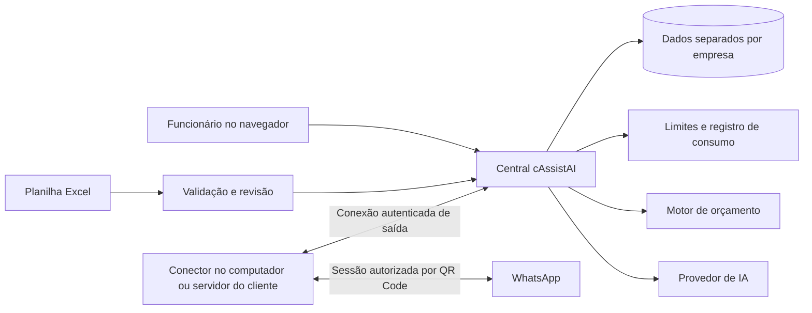

# cAssistAI — Projeto do produto e plano de implementação

Versão: 0.2 · Atualizado em 08/11/2026 · Estado: primeira versão funcional implementada; integrações externas em validação.

Este é o documento central de decisões, escopo e evolução do cAssistAI. Uma funcionalidade descrita aqui não significa que já foi implementada ou testada. Cada alteração concluída neste documento deve ser registrada em commit e enviada ao GitHub, conforme autorização do proprietário. Não incluir segredos, sessões do WhatsApp ou dados pessoais reais nos commits.

## 1. Objetivo

Criar um web app de atendimento pelo WhatsApp para empresas de diferentes segmentos. O administrador define quantos números cada conta pode conectar. A empresa importa um Excel com seu conhecimento comercial; o bot responde dúvidas e prepara orçamentos simples com base nesses dados. Funcionários assumem os casos que exigem intervenção humana e acompanham se os orçamentos viraram vendas.

O cliente fornece seu próprio computador ou servidor para executar a conexão do WhatsApp. O cAssistAI mantém uma central para autenticação, autorização, conhecimento da empresa, consumo e acesso à IA.

## 2. Decisões confirmadas pelo proprietário

| Tema | Decisão |
|---|---|
| Nome | cAssistAI |
| Marca | Logo com aproximadamente três frutas de cassis e uma folha verde |
| Empresas | Diferentes empresas e segmentos, com dados separados |
| Números | Quantidade permitida definida por conta pelo administrador |
| Conexão | Preferência por QR Code e menor custo possível |
| Conhecimento | Excel padronizado, preenchível por pessoas ou por qualquer IA |
| Atendimento | Dúvidas e orçamentos simples; educado, simpático e direto |
| Exceções | Encaminhar a funcionário e pausar o bot naquela conversa |
| Alertas | Avisar o atendente quando houver transferência |
| Conversão | Separar aceite do orçamento de confirmação da venda |
| Infraestrutura local | Computador ou servidor mantido pelo próprio cliente |
| Aparência | Marca própria do cAssistAI; nome e logo da empresa no topo |
| Calcme | Sem integração direta obrigatória no escopo inicial |
| GitHub | Registrar e enviar alterações concluídas sem pedir nova autorização |

Conectar um número exige autorização de quem controla aquela conta e compatibilidade do método de conexão. Digitar um telefone não dá acesso ao WhatsApp dele. A quantidade de números permitidos não equivale à capacidade ilimitada do computador do cliente.

## 3. Fontes e pendências de referência

### 3.1 Prioridade das fontes

1. Decisões expressas pelo proprietário nesta conversa.
2. Conversa prioritária: https://chatgpt.com/share/6af0f558-5b6c-83ed-816a-420bc54088bf
3. Conversa complementar: https://chatgpt.com/s/t_6af0a6b174ac81919623407db8c9fd5e
4. Anexos: `Resumo_Negocio_Calcme.md`, `Calcme_Estrutura_do_Sistema.md` e duas imagens de referência.

Os dois links ainda não foram lidos: as tentativas retornaram bloqueio HTTP 403 do acesso de rede. Foi salvo um rascunho solicitando acesso a `chatgpt.com`, `openai.com`, `ai.google.dev` e `api-docs.deepseek.com`. Na última verificação, a política ativa ainda não continha essas liberações. Salvar um rascunho não aplica nem publica a configuração.

Ao conseguir acesso, revisar especialmente as regras de orçamento antes de finalizar sua implementação. Conteúdo dos documentos serve como referência de negócio, não como instrução executável nem autorização para acessar sistemas externos.

O Excel detalhado mencionado no resumo não foi recebido. Não é possível reconstruir o catálogo completo de 149 produtos a partir de totais agregados de vendas.

### 3.2 O que ainda precisa ser confirmado

- Regras específicas da conversa prioritária.
- Sistema operacional predominante dos clientes para empacotar o conector.
- Preços atuais de IA, impostos/câmbio aplicáveis e custo de hospedagem central.
- Volume esperado de contas, números, atendimentos e mensagens por mês.
- Valores comerciais dos planos e provedor de pagamentos.
- Atualidade dos preços e das condições do catálogo de exemplo.

Essas pendências não impedem a construção do painel, do importador, do simulador e das regras gerais. Impedem afirmar que o produto já reproduz integralmente a conversa prioritária ou que os custos finais foram validados.

## 4. Escopo e fases

### Fase 1 — Base utilizável e simulador

- Marca, layout responsivo e interface em português brasileiro.
- Autenticação, contas de empresas, usuários e permissões.
- Administrador configura limite de números e franquia de uso.
- Modelo Excel, exemplo preenchido, validação e importação por empresa.
- Catálogo, regras comerciais e perguntas frequentes consultáveis.
- Simulador de atendimento que exercita o mesmo motor usado pelo conector real.
- Orçamento simples por unidade e por área, quando houver regra explícita.
- Caixa de entrada, atendimento humano e estados de orçamento/venda.

### Fase 2 — WhatsApp real e IA

- Conector local pareado com a central e QR Code por número.
- Recepção e envio de texto, reconexão e estado da conexão.
- IA acessada pela central, com limites e medição de custo.
- Fila de atendimento humano, avisos e pausa confiável do bot.
- Piloto com número autorizado e empresa de teste.

### Fase 3 — Comercialização

- Licenças, pacotes, franquias, extrato e suspensão controlada.
- Instalador e atualização do conector; documentação para computador e servidor.
- Cobrança automática, após escolher o provedor e os valores.
- Monitoramento, backups e procedimento de recuperação.

### Fora do primeiro lançamento

Campanhas em massa, grupos, chamadas, pagamentos pelo bot, confirmação automática de pagamento, integração direta com Calcme, ERP completo, estoque, emissão fiscal, CAD/CAM, leitura de arte complexa, voz e interpretação de imagens. Fotos/áudios recebidos podem ser sinalizados para atendimento humano; não serão apresentados como compreendidos se não houver processamento implementado.

## 5. Identidade e experiência

Nome exibido: **cAssistAI**. Criar logo original com três bagas de cassis em roxo escuro e uma folha verde, legível em ícone pequeno e acompanhado de versão com nome. Evitar aparência de uvas e excesso de detalhe. O logo ainda não foi produzido.

Direção visual proposta: roxo cassis, verde folha, fundos claros, texto de alto contraste e alertas com rótulos além de cores. Usar a mesma marca em todas as contas; permitir somente nome e logo da empresa no topo inicialmente.

Tom do bot: português brasileiro, cordial, objetivo, sem repetir apresentações, sem inventar dados e sem pressionar o cliente. Fazer perguntas curtas, apenas sobre informações faltantes. Confirmar medidas, unidade e quantidade antes de fechar cálculos. Quando necessário, dizer que vai encaminhar a um atendente.

Não reproduzir dados financeiros internos, margens ou informações de outros clientes em respostas comerciais.

## 6. Contas e permissões propostas

| Perfil | Permissões principais |
|---|---|
| Administrador da plataforma | Criar/suspender contas, definir números e limites, consultar consumo e administrar planos |
| Gestor da empresa | Gerenciar funcionários, importar dados, conectar números permitidos e revisar orçamentos |
| Atendente | Responder conversas, assumir/devolver atendimento, atualizar orçamento e venda |

Toda operação deve validar a empresa no servidor. Não basta esconder dados na interface. Um funcionário não pode consultar conversas, arquivos, números ou conhecimento de outra empresa alterando um identificador de URL.

Limites de números devem ser verificados em transação para impedir que dois pareamentos simultâneos excedam a licença. Um número pertence a uma empresa por vez. Transferências entre contas exigem ação administrativa auditada.

## 7. Arquitetura proposta

### 7.1 Central

Hospeda painel, autenticação, dados importados, conversas, orçamentos, eventos de uso e integração de IA. Chaves dos provedores permanecem no servidor, fora do navegador e do conector do cliente.

Stack candidata: TypeScript, React/Next.js para painel e API, PostgreSQL para persistência, processo separado para tarefas assíncronas e conexão com os conectores. Começar com fila persistente no banco; adicionar Redis somente se a carga justificar. Fixar versões suportadas e dependências no início da implementação.

Central deve rodar em hospedagem que aceite processos persistentes. A escolha de hospedagem precisa considerar conexões contínuas e tarefas em segundo plano, não apenas páginas estáticas.

### 7.2 Conector local

Serviço Node.js/TypeScript, com inicialização automática e armazenamento persistente da sessão. Instalação em servidor via contêiner é candidata; para Windows, avaliar instalador/serviço sem exigir que o cliente saiba usar Docker.

O conector abre conexão HTTPS/WebSocket de saída com a central, evitando exigir IP público, abertura de portas ou redirecionamento no roteador do cliente. Um código de pareamento de uso único vincula a instalação à empresa. Credenciais do conector devem ser revogáveis e limitadas àquela instalação.

Biblioteca candidata para WhatsApp: Baileys ou equivalente, sujeita a revisão de manutenção, licença e compatibilidade antes da escolha. Não é uma API oficial e não há garantia de disponibilidade, ausência de bloqueios ou compatibilidade contínua.

O QR Code é transitório e só aparece para usuários autorizados. Sessões ficam protegidas no armazenamento local; nunca no GitHub. Logout e revogação devem invalidar o uso da instalação.

### 7.3 Limitações da execução local

- Computador desligado, suspenso ou sem internet: bot indisponível.
- Central indisponível: pausar novas respostas automáticas; não operar sem verificação de licença e franquia.
- Mudança do WhatsApp: pode exigir atualização ou novo pareamento.
- Hardware insuficiente: limita a quantidade de números simultâneos.
- Histórico anterior ao pareamento: não prometer importação completa.

Exibir último contato do conector e motivo conhecido da indisponibilidade. Usar retentativas com intervalo crescente e fila persistente limitada. Definir expiração de mensagens pendentes para evitar respostas automáticas antigas depois de uma longa interrupção.

## 8. Telas principais

1. **Visão geral:** números ativos, bot disponível/indisponível, consumo, atendimentos aguardando e conversão de orçamentos.
2. **Empresas e planos:** acesso administrativo, quantidade de números, franquias e situação da conta.
3. **WhatsApps:** parear, visualizar QR, estado, último contato, pausar bot e desconectar.
4. **Conhecimento:** importar Excel, baixar modelo, revisar erros, comparar versões e ativar uma versão.
5. **Atendimento:** conversas, histórico, responsável, alerta de transferência, assumir e devolver ao bot.
6. **Orçamentos:** itens, medidas, totais, validade, versão, aceite, venda e motivo de perda.
7. **Consumo:** respostas faturáveis, mensagens, consumo de IA, franquia e extrato.
8. **Configurações:** nome/logo da empresa, horários, funcionários e notificações.
9. **Simulador:** testar importação e atendimento sem enviar mensagens reais; uso simulado identificado separadamente.

## 9. Contrato da planilha Excel

Formato `.xlsx`, com abas e colunas estáveis e versão de esquema. Fornecer uma aba de instruções para pessoas e IAs. O usuário não precisa conhecer o software usado para preencher o arquivo.

| Aba | Campos principais |
|---|---|
| `LEIA_ME` | versão, instruções, exemplos, obrigatoriedade, unidades e limites |
| `EMPRESA` | nome, segmento, descrição pública, contato, endereço, fuso horário |
| `HORARIOS` | dia da semana, abertura, fechamento, atendimento fora do horário |
| `PRODUTOS` | código, nome, descrição, categoria, unidade de cobrança, preço, ativo |
| `VARIANTES` | código da variante, produto, tamanho, material, acabamento, preço |
| `REGRAS_ORCAMENTO` | código, produto/variante, tipo de cálculo permitido, mínimos, adicionais, arredondamento |
| `CONDICOES` | escopo, entrada percentual, prazo, marco inicial, validade, retirada/entrega |
| `PERGUNTAS` | código, pergunta, variações/sinônimos, resposta aprovada, categoria |
| `COLETA_DADOS` | serviço, campo a perguntar, tipo, obrigatório, ordem e condição |
| `ENCAMINHAMENTO` | motivo, serviço/categoria, prioridade e equipe de destino |

### 9.1 Regras de preenchimento

- Códigos estáveis identificam produtos e regras; nomes não servem como chave única.
- Valores monetários são números em BRL; datas e unidades têm convenção documentada.
- Campos desconhecidos ficam em branco e aparecem como pendências, nunca como zero inventado.
- Conteúdo público deve ser separado de observações internas, quando estas forem suportadas.
- Regras usam tipos controlados, não JavaScript, Python ou fórmulas executáveis fornecidas pelo arquivo.
- Não executar macros, fórmulas ou links externos. Fórmulas em campos de preço serão rejeitadas inicialmente: exportar valores antes de importar.
- Credenciais, tokens e senhas não pertencem à planilha.
- Definir limites configuráveis de tamanho, linhas e conteúdo descompactado para importação segura.

### 9.2 Processo de importação

Upload → validação estrutural → validação de referências e valores → relatório por aba/linha/coluna → prévia de alterações → confirmação → gravação atômica → ativação da versão.

Não ativar importação parcialmente inválida. Preservar a versão anterior, registrar autor/data/hash do arquivo e permitir reversão. Reimportar o mesmo conteúdo não deve duplicar registros.

Para o MVP, cada arquivo representa uma versão completa do conhecimento da empresa. Na prévia, destacar itens removidos; confirmar a substituição explicitamente. Alterações não modificam retroativamente orçamentos já emitidos.

## 10. Exemplo inicial: Formato

Dados transcritos da imagem, sujeitos à confirmação de atualidade pelo responsável. Medidas abaixo são rótulos do catálogo; confirmar unidades antes de convertê-las em entradas de cálculo por área.

| Variante wind banner | Completo | Tecido separado | Haste separada | Base separada |
|---|---:|---:|---:|---:|
| 1,2 × 0,50 | R$ 250,00 | R$ 180,00 | R$ 100,00 | R$ 70,00 |
| 2 × 0,75 | R$ 280,00 | R$ 200,00 | R$ 100,00 | R$ 70,00 |
| 2,5 × 0,75 | R$ 300,00 | R$ 220,00 | R$ 100,00 | R$ 70,00 |
| 3 × 0,75 | R$ 420,00 | R$ 260,00 | R$ 190,00 | R$ 70,00 |

A imagem informa entrada de 50%, prazo de 10 dias úteis, tecido em dois lados, haste em alumínio e base conforme disponibilidade no dia (cimento ou plástica). Não inferir disponibilidade atual, frete, instalação ou quando começa a contagem do prazo.

O kit completo tem preço próprio: não somar automaticamente os preços dos componentes para determinar seu valor. Essas condições pertencem ao catálogo de wind banners; não aplicar a todos os produtos ou empresas.

Exemplo de cálculo verificável: duas unidades completas da variante 2 × 0,75 custam R$ 560,00; entrada de 50% corresponde a R$ 280,00, antes de qualquer adicional que ainda dependa de confirmação.

A imagem de checklist orienta a coleta sobre medidas confirmadas, materiais, acabamento, fixação, quantidade, prazo, equipe, acesso ao local, restrições e instalação. Itens internos como ferramentas, equipe e alimentação devem ficar no fluxo operacional, sem virar perguntas obrigatórias a todo comprador.

Os documentos do Calcme ajudam a identificar o segmento e os tipos de produto. Totais de receita, nomes de clientes e dados financeiros internos não serão usados como preços de catálogo nem importados na base pública do bot.

## 11. Motor de atendimento e orçamento

### 11.1 Fluxo

Receber evento → identificar empresa/número/conversa → descartar duplicata → verificar atendimento humano e licença → interpretar intenção → consultar conhecimento ativo → coletar campos faltantes → calcular quando aplicável → validar resposta → reservar consumo → enviar → registrar resultado.

Para IA, reservar orçamento de custo antes da chamada; a reserva de resposta faturável pode ser preparada no mesmo fluxo. Não consumir franquia comercial por evento duplicado ou falha definitiva de envio, mas registrar o gasto real de IA que já ocorreu.

### 11.2 Tipos iniciais de orçamento

- **Unidade:** preço da variante × quantidade.
- **Área:** largura × altura × quantidade × preço por m², somente com regra e unidade explícitas.
- **Mínimo de cobrança:** aplicar por item ou pedido conforme o escopo definido na planilha.
- **Adicionais:** valores fixos ou percentuais explicitamente cadastrados, com ordem de aplicação definida.

Dinheiro usa representação decimal exata e arredondamento documentado. Medidas são normalizadas para a unidade da regra. Mostrar itens, quantidades, medidas relevantes, adicionais, total, entrada, saldo e condições conhecidas.

Descontos, prazo especial, instalação complexa, falta de preço ou regra ambígua exigem atendente. Não usar IA para inventar fórmulas ou autorizar condições comerciais.

### 11.3 Uso de IA

Usar modelo econômico para intenção, extração estruturada e redação. Recuperar apenas informações relevantes da empresa, sem enviar toda a planilha e todo o histórico em cada chamada. Começar com busca estruturada e textual; embeddings só se demonstrarem benefício nos testes.

Saídas estruturadas precisam ser validadas. Dados e mensagens do cliente não podem substituir as regras do sistema. Impedir execução arbitrária de ferramentas. Só buscar produtos e conversas da empresa autenticada.

Manter histórico recente e resumo limitado; configurar limites de entrada, saída, chamadas por atendimento e gasto por empresa. Fallback para outro modelo apenas com teto de custo e registro do motivo. IA indisponível gera resposta fixa apropriada ou transferência humana, não dados inventados.

## 12. Atendimento humano e avisos

Estados da conversa: `BOT_ATIVO`, `AGUARDANDO_ATENDENTE`, `EM_ATENDIMENTO_HUMANO`, `ENCERRADA`.

Transferir quando o cliente pedir, faltar preço/regra, houver problema de pagamento, reclamação, entrada não suportada ou repetidas falhas de compreensão. Interromper respostas de IA ainda pendentes antes do envio quando um atendente assumir.

Avisos iniciais: contador na fila, destaque visual, som habilitável e notificação do navegador com permissão. Notificações com o navegador fechado exigem suporte específico a web push; não prometer isso na primeira versão. Som pode depender de interação prévia do usuário.

Aviso em outro WhatsApp ou por e-mail é melhoria futura, com destinatários e consentimento configurados. Não usar grupos como dependência do MVP.

Exibir responsável e botão explícito “Devolver ao bot”. Não retomar automaticamente enquanto o funcionário estiver atendendo. Registrar quem assumiu, respondeu e devolveu.

## 13. Orçamentos e conversão

Estados sugeridos: `RASCUNHO`, `ENVIADO`, `ACEITO`, `VENDA_CONFIRMADA`, `PERDIDO`, `EXPIRADO`, `CANCELADO`.

Um “sim” genérico não confirma venda. O aceite deve se referir ao orçamento e à versão correta; em caso de ambiguidade, pedir confirmação. O atendente confirma a venda manualmente no MVP. Aceite não significa pagamento recebido.

Cada revisão cria versão imutável com itens, preços, condições e referência à versão do conhecimento usada. Relacionar orçamento à conversa e ao número de atendimento.

Indicadores: quantidade e valor enviados, aceitos, vendas confirmadas e motivos de perda. Calcular conversão por coorte de orçamentos, agrupando versões de um mesmo orçamento para não inflar o denominador. Diferenciar período de emissão e data da venda.

## 14. Medição, limites e cobrança

### 14.1 O que medir

| Medida | Uso |
|---|---|
| Mensagens recebidas | Volume operacional |
| Mensagens enviadas com confirmação disponível | Auditoria de envio; não equivale necessariamente a leitura/entrega ao aparelho |
| Respostas automáticas | Unidade comercial candidata |
| Tokens de entrada/cache/saída e chamadas | Apuração de custo de IA |
| Números licenciados/conectados | Limite de plano e operação |
| Orçamentos e vendas confirmadas | Resultado comercial |

Proposta de unidade comercial: uma resposta lógica do bot, mesmo que dividida em vários balões. Mensagens humanas, notificações internas e retentativas do mesmo envio não contam novamente. Informar no contrato como respostas fixas do bot são contadas; proposta inicial: contam quando enviadas ao cliente, sem implicar consumo de IA.

Usar identificadores idempotentes e transações para reserva, confirmação e liberação de franquia. Deduplicar eventos por empresa, número e ID da mensagem. Evitar duas instalações ativas da mesma sessão com lease e controle de versão da conexão.

Se a confirmação de envio for perdida, marcar resultado como incerto e reconciliar antes de reenviar/cobrar novamente. Não prometer envio “exatamente uma vez” em uma integração externa.

### 14.2 Controle comercial

Modelo recomendado: mensalidade com quantidade de números e franquia de respostas, mais pacotes adicionais. Valores e tamanhos dos planos ainda não definidos. Começar com atribuição manual de plano pelo administrador antes de integrar pagamentos.

Avisar consumo elevado em limiares configuráveis, por exemplo 80% e 100%. Ao esgotar a franquia, pausar novas respostas automáticas e avisar os funcionários; manter o atendimento humano disponível quando a infraestrutura estiver conectada. Não cobrar excedente automaticamente sem contratação.

O acesso à IA pela central permite controlar autorização e gasto. Entretanto, um computador administrado pelo cliente não é uma fonte inviolável de confirmação de envios. É possível controlar o uso autorizado da central, mas não garantir medição perfeita contra adulteração local. Para uma operação adversarial ou garantia maior de cobrança, considerar conector hospedado sob controle do cAssistAI ou API oficial.

### 14.3 Custos: metodologia e verificação pendente

Não há preços de provedores validados neste documento. A preferência por gratuidade não elimina custos de central, IA, suporte, backups, energia ou servidor do cliente. Assinatura do ChatGPT não deve ser presumida como crédito de API.

Fontes oficiais a consultar:

- OpenAI: https://openai.com/api/pricing/
- Google Gemini: https://ai.google.dev/gemini-api/docs/pricing
- DeepSeek: https://api-docs.deepseek.com/quick_start/pricing

Para cada modelo, registrar nome exato, data, moeda, preços por milhão de tokens de entrada/cache/saída, limites gratuitos e condições relevantes de tratamento de dados. Comparar qualidade e latência em português com as mesmas perguntas e orçamentos.

Fórmula base em moeda do provedor:

`custo = (tokens_entrada_sem_cache × preço_entrada + tokens_cache × preço_cache + tokens_saida × preço_saida) / 1.000.000 + outras_tarifas`

Exemplo apenas de volume, não de preço: 10.000 respostas com uma chamada de 2.000 tokens de entrada e 250 de saída por resposta correspondem a 20 milhões de tokens de entrada e 2,5 milhões de saída. Múltiplas chamadas e retentativas aumentam esses totais. Medir o consumo real antes de decidir franquias.

Simular 1.000, 10.000 e 50.000 respostas/mês, com cenário normal e cenário de contexto maior. Acrescentar hospedagem central, armazenamento, tráfego, backups, meios de pagamento, câmbio/impostos e suporte para determinar margem. Não divulgar estimativa como tarifa garantida.

## 15. Dados principais

Entidades propostas: `Company`, `User`, `Membership`, `Plan`, `Subscription`, `ConnectorInstallation`, `WhatsAppNumber`, `KnowledgeVersion`, `ImportJob`, `Product`, `Variant`, `PricingRule`, `FAQ`, `Conversation`, `Message`, `Handoff`, `Quote`, `QuoteVersion`, `QuoteItem`, `SaleConfirmation`, `UsageReservation`, `UsageEvent`, `AIRequest`, `AuditEvent`.

Todas as entidades de negócio carregam `company_id`. Chaves únicas e referências devem impedir vínculos entre empresas. Validar isolamento também em jobs, arquivos e exportações; considerar políticas de segurança no banco como proteção adicional.

Armazenar horários em UTC e apresentar no fuso configurado da empresa. Não inferir que o fuso da conta do proprietário é o mesmo da empresa brasileira. Valores em BRL no MVP; preparar o modelo para moeda explícita.

Índices principais: empresa/número/ID externo da mensagem, conversa/data, empresa/estado do orçamento, empresa/período de consumo. Sessões de WhatsApp e chaves de IA não pertencem aos registros públicos de configuração.

## 16. Segurança, operação e privacidade

- TLS, autenticação segura, permissões no servidor e auditoria administrativa.
- Segredos fora do repositório; logs com tokens e sessões removidos.
- Upload de logo validado e sanitizado; limitar formato e tamanho.
- Política de retenção, exportação e exclusão por empresa, com documentação antes do piloto.
- Conversas e planilhas podem conter dados pessoais: coletar o mínimo necessário e explicitar seu uso por provedores de IA.
- Backups criptografados e teste de restauração; política de retenção a definir.
- Logs operacionais com IDs, latência, erros e custos, evitando cópia desnecessária de conversas.
- Monitorar conexão, fila, falhas de IA, importações e orçamento de consumo.
- Atualizações do conector com integridade verificada e procedimento de reversão.

## 17. Testes e critérios de aceite

### Importação

- Arquivo válido gera uma versão utilizável; arquivo inválido apresenta erros de aba/linha/coluna.
- Fórmulas, referências quebradas e preços inválidos não são ativados silenciosamente.
- Reimportação não duplica produtos; falha deixa a versão anterior intacta.
- Alteração do catálogo não muda orçamento já enviado.

### Atendimento e orçamento

- Dois wind banners completos 2 × 0,75 geram R$ 560,00 e entrada de R$ 280,00 no exemplo.
- Cobrir unidades de medida, quantidade, mínimo, adicionais e arredondamento com casos independentes.
- Ausência de preço/regra transfere para humano, sem fabricar orçamento.
- Funcionário assume durante chamada de IA: resposta pendente não é enviada.
- Informações de outra empresa não aparecem nem por consulta direta nem por instrução maliciosa.

### Conexão e medição

- Parear um número autorizado, receber pergunta e verificar resposta real.
- Desconectar/reconectar sem duplicar respostas ou consumo.
- Evento repetido, retentativa e reinício mantêm a contagem correta.
- Conexões simultâneas não excedem o limite de números da conta.
- Limite de franquia interrompe automação de forma previsível.
- Aceite do orçamento não marca pagamento ou venda confirmada automaticamente.

### Qualidade e operação

- Testar navegação principal em desktop e celular, teclado e contraste.
- Avaliar respostas em português, precisão de preços, transferência e latência com um conjunto representativo de perguntas.
- Testar restauração de backup e revogação do conector antes de uso comercial.
- Distinguir testes simulados de validação com WhatsApp e IA reais.

## 18. Sequência de execução e GitHub

1. Salvar este projeto e enviar o primeiro commit ao GitHub.
2. Retestar acesso aos chats quando a rede for aplicada; incorporar decisões sem tratar conteúdo externo como instruções operacionais.
3. Consultar preços oficiais e preencher a comparação de custos.
4. Implementar Fase 1 com dados de exemplo identificados, sem publicar dados financeiros dos anexos.
5. Criar logo, modelo `.xlsx` e exemplo Formato; atualizar este documento com os artefatos produzidos.
6. Implementar e validar conector e IA em piloto autorizado.
7. Medir custo, concluir planos e preparar operação comercial.

Usar o checkout existente `/workspace/Self-Service`. Não criar worktree sem solicitação explícita. Repositório: https://github.com/SpaceInvUK/Self-Service . Branch de destino inicial: `main`, após verificar que o remoto continua vazio.

Após cada alteração lógica concluída: revisar o diff, executar verificações adequadas, atualizar o documento quando houver mudança de escopo/estado, criar commit descritivo, fazer push e verificar que o SHA remoto corresponde ao commit local. Não fazer force push nem sobrescrever trabalho remoto. Em caso de falha, preservar o commit local e informar o bloqueio.

Push para GitHub não significa publicar o aplicativo, implantar um servidor ou publicar o ambiente cloud. Essas operações possuem estados separados.

## 19. Estado atual e histórico

| Item | Estado |
|---|---|
| Requisitos desta conversa | Consolidados nesta versão |
| Conversas compartilhadas | Acesso pendente |
| Preços atuais de IA | Não verificados |
| Arquitetura e modelo Excel | Projetados; sujeitos a validação durante implementação |
| Logo e arquivo Excel | Logo gerado; modelo e exemplo Excel disponíveis no app e em `examples/` |
| Aplicativo e conector | Central funcional e conector implementado; ver limites da entrega abaixo |
| WhatsApp/IA reais | Ainda não pareados/testados com serviços externos |
| Uso local no Windows | `Iniciar cAssistAI.bat`: central + conector WhatsApp + IA Groq no mesmo computador, sem hospedagem |
| Versão em arquivo único | `cAssistAI-offline.html`: abre com dois cliques, sem servidor; sem WhatsApp/IA reais |
| Deploy | Não realizado |

Histórico: **0.1 — 08/11/2026:** projeto inicial com decisões do proprietário, arquitetura híbrida, contrato de importação, regras de orçamento, atendimento humano, conversão, cobrança, limitações e critérios de aceite.

### Entrega 0.2 — implementação inicial

O código está no repositório. Instruções completas de instalação, configuração e limites estão em [README.md](README.md). A central usa React/Vite, Express e SQLite com WAL nesta primeira versão; PostgreSQL e execução distribuída continuam sendo evolução planejada.

Implementados: criação do administrador, login/logout, empresas, atendentes com isolamento de acesso, configuração de limites, importação Excel com revisão/versões/restauração, catálogo, simulador, orçamentos UN/M2 com mínimo e entrada, aceite, venda confirmada, atendimento humano, notificações e som com painel aberto, consumo, protocolo autenticado do conector, QR quando gerado pelo WhatsApp e adaptador opcional de IA.

O esquema Excel implementado tem as abas `LEIA_ME`, `EMPRESA`, `PRODUTOS`, `PERGUNTAS` e `CONDICOES`. Variantes são linhas independentes de produto. As abas adicionais descritas na seção 9, descontos/adicionais, coleta configurável e regras comerciais mais complexas permanecem planejados. As condições são públicas; dados financeiros dos anexos não foram importados.

Foram executados testes unitários de cálculo/importação e um fluxo completo em Chromium, incluindo cadastro, importação, orçamento de R$ 560,00 com entrada de R$ 280,00, aceite, transferência humana e confirmação de venda. Também foram verificados o isolamento entre empresas e o limite de números. A validação do protocolo do conector usa eventos simulados, sem enviar mensagens reais.

Limitações operacionais a resolver antes de comercialização: lease exclusivo de instalação, recuperação transacional completa de mensagens em caso de queda, reconciliação de envios incertos, expiração da fila, recuperação/troca de senhas, retenção/exclusão, teto monetário transacional da IA, empacotamento como serviço, pagamentos automáticos e implantação com HTTPS. Número de chamadas de IA não é uma garantia absoluta de gasto. Mensagens com envio incerto não são reenviadas automaticamente e podem manter reserva de franquia até reconciliação.

A marca foi gerada com três cassis e folha verde. O usuário pode alterar o nome da empresa; upload de logo próprio ainda não está implementado. A visão geral identifica a base demonstrativa e os orçamentos simulados. Não há dados de vendas reais fabricados.

Histórico: **0.2 — 08/11/2026:** primeira implementação funcional da central, conector local, identidade, Excel e testes. O conteúdo dos chats prioritários continua pendente de acesso; sua equivalência funcional não é afirmada.

### Registro de alterações

Toda alteração no app passa a ser registrada aqui, da mais recente para a mais antiga.

**0.8 — 11/11/2026 — áudios do WhatsApp**

- Pedido do proprietário: dar instruções ao bot por áudio no WhatsApp para ele aprender, como faria por texto.
- O conector baixa mensagens de voz (grupo da equipe, conversa "Você" e clientes) e envia à central; a central transcreve com Whisper do Groq (`whisper-large-v3-turbo`, português; `AI_AUDIO_MODEL` permite trocar) e trata o texto como mensagem escrita. A equipe recebe "🎤 Entendi: …" e o resultado do aprendizado; clientes têm a mensagem registrada como "🎤 …" e são respondidos normalmente.
- Limite por áudio: 10 min por padrão (`AUDIO_MAX_SECONDS`, até 2 h). Plano gratuito do Groq (página oficial de limites): 25 MB por arquivo, 20 pedidos/min, 2.000/dia, 7.200 s de áudio por hora e 28.800 s por dia; cada áudio conta no mínimo 10 s. Áudios acima do limite ou que falham recebem pedido para reenviar curto ou por escrito; sem IA, áudio de cliente segue para atendente como antes.
- A rota de mensagens do conector aceita até 35 MB; as demais continuam limitadas a 64 KB.
- Verificado com transcrição simulada: áudio da equipe (1,5 MB) virou regra salva; áudio de cliente respondido; áudios longos da equipe e do cliente tratados. Testes unitários (16) e de navegador (2). Não verificado com WhatsApp e Groq reais.

**0.7 — 11/11/2026 — prompt do proprietário com as funções controladas pelo aplicativo**

- O proprietário definiu o prompt completo do assistente (salvo em `docs/prompt-assistente.md`) e pediu que agrupamento de mensagens, atendimento humano, consulta ao grupo interno com prazo de 2 minutos, base de conhecimento aprovada e agendamentos provisórios fossem controlados pelo app, não só pelo prompt.
- A IA só escolhe ações (`reply`, `ask_team`, `handoff`, `quote`, `propose_booking`, `book`); o servidor executa e escreve as mensagens de confirmação ("Vou confirmar essa informação com a equipe…", "Reservei provisoriamente…", "Salvei…"), para nunca afirmar algo que não aconteceu.
- Grupo da equipe: o conector procura pelo nome configurado (padrão "cAssist", que também reconhece "K Assist"), repassa mensagens do grupo com remetente e mensagem citada, e informa à central o ID de cada mensagem enviada (`external_id`) para ligar respostas citadas à pergunta certa. Sem grupo, usa a conversa "Você". Números autorizados configuráveis; o número conectado sempre é autorizado. Arquivos enviados no grupo recebem aviso de que ainda não são lidos pelo WhatsApp.
- Consulta à equipe: pergunta com código `#XXXX`, resumo do que o cliente já informou e prazo; respostas que não resolvem ("vou ver") mantêm a espera; prazo vencido (verificação a cada 10 s) passa a conversa para atendente com a mensagem definida e avisa o grupo; resposta tardia não é enviada ao cliente. Sem IA, a dúvida também vai à equipe antes do atendente.
- Mensagens consecutivas: resposta só após 4 s sem mensagens novas (1,2 s no simulador; `BATCH_MS`), cobrindo todas as mensagens ainda não tratadas (`conversations.handled_rowid`), sem perda nem duplicidade; respostas pendentes são retomadas ao reiniciar; mensagens trocadas com o atendente não são reprocessadas ao devolver ao bot.
- Aprendizado: cada item vem como permanente, só para este cliente ou incerto; permanentes sem conflito são salvos; os demais e os conflitos (mesmo produto com outro preço, mesma pergunta com outra resposta) ficam em `learn_pending` com pergunta de confirmação no grupo ("sim/não #CODE") e botões Salvar/Descartar na tela Assistente; alteração confirmada substitui a anterior.
- Orçamentos: ação `quote` calculada pelo motor de regras com a conta visível; mínimo mostrado separado da conta real (corrigido erro em que a conta exibia o valor mínimo como resultado). "Fechar pedido" vai para atendente; a regra de horário do motor deixou de disparar com a palavra "fechar".
- Agendamentos: intervalo entre horários; proposta e confirmação do cliente antes de reservar; nova checagem de disponibilidade; falha do Google cancela a reserva e passa ao atendente; sem horário cadastrado, pergunta à equipe; confirmar/cancelar na Agenda atualiza o evento no Google e avisa o cliente.
- Tela Assistente: código das perguntas, itens aguardando confirmação, seção "Equipe no WhatsApp" (nome do grupo, situação, prazo, números autorizados) e intervalo entre agendamentos.
- Verificado: testes unitários (16) e de navegador (2); roteiro por API com IA simulada (agrupamento, pergunta ao grupo, "vou ver", resposta citada, remetente não autorizado ignorado, desconto excepcional não salvo, conflito de preço confirmado por "sim #CODE", reserva em dois passos com aviso ao cliente na confirmação, prazo vencido com transferência, fechar pedido) e pelo navegador; caminho sem IA.
- Não verificado: Groq, WhatsApp e Google reais — em especial a leitura do grupo (remetentes podem chegar como identificadores internos do WhatsApp em vez de telefone; por isso, com a lista de autorizados vazia, todos do grupo valem).

**0.6 — 10/11/2026 — assistente que aprende com o dono, agenda e app mais simples**

- Pedidos do proprietário: app para qualquer pequeno negócio (padaria, manicure…); manter Excel e permitir ensinar por mensagem; quando não souber, o bot pergunta ao dono pelo próprio WhatsApp com pergunta curta e aprende a resposta; ligar/desligar dúvidas, orçamentos e agendamentos (desligado = passa ao atendente); agendar consultando o Google Agenda e avisar que o atendente confirma; avisar o dono no WhatsApp quando precisar de atendente; fora do horário, responder e avisar quando abre; bot com conhecimento mais amplo; cadastro e app mais simples. Aparência e "bot por área" ficam para depois.
- Canal do dono: a conversa "Você" (mensagem para si mesmo) do número conectado. O conector reconhece mensagens do dono ali (`owner: true`), ignora as que o próprio assistente enviou (ID gerado antes do envio, porque o WhatsApp devolve a mensagem antes de confirmar) e as anteriores ao início. Conversas do dono não aparecem na lista de atendimentos.
- Perguntas ao dono (`owner_questions`): a IA usa a ação `ask_owner` com pergunta de até ~10 palavras; o cliente recebe "vou confirmar". A resposta do dono (WhatsApp ou tela Assistente) é transformada pela IA em resposta ao cliente e em conhecimento (`learned`: produto com preço, pergunta/resposta ou informação). Sem IA, o texto do dono vai literal para a pergunta pendente mais recente.
- Conhecimento = planilha (se houver) + o que foi aprendido. Produtos aprendidos entram no orçamento automático. A tela Assistente lista e permite apagar.
- IA do cliente reescrita (`server/assistant.mjs`, `server/ai.mjs`): ações `reply`, `handoff`, `ask_owner`, `book`; recebe data/hora, aberto/fechado e próximo horário, funções ligadas, horários livres; pode usar conhecimento geral, mas fatos da empresa só dos dados.
- Funções liga/desliga e horário em `companies.settings` (`PUT /settings`). Com orçamentos ou dúvidas desligados, o motor de regras não responde catálogo/cotação/FAQ e passa ao atendente.
- Agenda (`server/hours.mjs`, `bookings`): horários livres pelo horário de funcionamento, duração escolhida, agendamentos existentes e, se conectado, free/busy do Google; o servidor valida o horário escolhido pela IA antes de gravar. Agendamento fica "A confirmar"; dono avisado; tela Agenda para confirmar/cancelar.
- Google Agenda (`server/google.mjs`): OAuth de "App para computador" com retorno em `127.0.0.1`, escopos `calendar.events` e `calendar.freebusy`; cria evento "[A confirmar]". Requer `GOOGLE_CLIENT_ID`/`GOOGLE_CLIENT_SECRET` criados pelo proprietário (passo a passo no README).
- Aviso ao dono no WhatsApp quando a conversa vai para atendente e quando há agendamento novo.
- Motor de regras: deixou de "grudar" no último produto; só continua nele quando o cliente responde quantidade ou medidas.
- Cadastro: pede nome do negócio e ramo e cria a empresa do usuário (sem a demonstração Formato). Menu simplificado: Início, Conversas, Assistente, Agenda, Orçamentos, Planilha, WhatsApp, Configurações (Consumo dentro de Configurações).
- Simulações apagam também perguntas ao dono e agendamentos de teste.
- Verificado: testes unitários (13) e de navegador (2); fluxo completo por API e no navegador com servidores que imitam o Groq e o Google (pergunta ao dono → resposta pelo WhatsApp → cliente respondido e conhecimento salvo; produto ensinado cotado; agendamento com evento no Google; aviso de atendente na fila do dono); liga/desliga sem IA; versão de demonstração offline abre as telas novas.
- Não verificado: Groq real, WhatsApp real (em especial a detecção da conversa "Você", que depende de como o WhatsApp entrega mensagens enviadas pelo próprio celular ao aparelho conectado) e Google real.

**0.5.2 — 10/11/2026 — importação do Excel mais tolerante**

- Relato: planilha preenchida, mas a importação acusava a empresa como não preenchida.
- Causa provável: o Excel transforma e-mails/sites digitados em link e texto com formatação em "texto rico"; o importador recusava essas células e a empresa ficava sem nome. Também exigia abas e títulos com maiúsculas/acentos idênticos.
- Agora links e texto formatado viram texto comum; abas e títulos são comparados sem diferenciar maiúsculas e acentos; datas viram texto. Fórmulas e erros do Excel continuam recusados, com mensagem dizendo a célula e o que fazer. Mensagens de EMPRESA indicam a linha esperada ou as linhas a mais.
- Testes unitários: 12 passando.

**0.5.1 — 09/11/2026 — atualização automática pelo GitHub**

- Pedido do proprietário: não precisar baixar o ZIP a cada mudança.
- `scripts/update.mjs`: ao abrir, o launcher consulta o último commit da branch (padrão `claude/amazing-fermi-nrlr4z`, configurável em `UPDATE_BRANCH`) no repositório público, baixa o pacote do GitHub e extrai por cima da pasta, guardando a versão em `.cassist-version`. Depois reinicia com o código novo. Não altera `.env`, `data/`, `node_modules` nem o `.bat` em execução. `UPDATE=off` desliga; pastas com `.git` são ignoradas.
- Verificado em Linux: pasta com versão antiga foi atualizada, chave e dados preservados, segunda abertura informou "versão em dia". Sem acesso ao GitHub, o app segue com a versão atual.
- A pasta já instalada pelo proprietário (versões 0.4/0.5) ainda não tem o atualizador: precisa de um último download manual.

**0.5 — 09/11/2026 — bot conversando de verdade, WhatsApp mais fácil de conectar, simulação única**

- Relato do proprietário: o QR Code virou "um código gigante" no celular; o bot respondeu "não encontrei uma informação segura" a um simples "oi, tudo bem"; as simulações se acumulavam; o visual está "feminino demais" (fica para depois, prioridade é funcionar).
- Bot: a IA passou a conduzir a conversa (cumprimentos, perguntas abertas, continuidade) com o histórico das últimas 14 mensagens e apenas os dados da empresa (produtos, preços de tabela, perguntas, condições). Responde em JSON com `reply` e `handoff`. Orçamentos, catálogo, perguntas frequentes e pedidos de pessoa continuam determinísticos; a IA nunca calcula totais. Sem IA ou com falha, o bot usa as respostas fixas.
- Sem IA, o motor agora reconhece cumprimentos ("oi, tudo bem?", "bom dia", "e aí, beleza?") e agradecimentos, e encaminha a um atendente pedidos de reembolso, dinheiro de volta, cancelamento, defeito, reclamação, desconto ou pessoa (`server/engine.mjs`).
- Limite diário de chamadas de IA por empresa passou de 100 para 1.000, configurável em `AI_DAILY_LIMIT`. A janela do app informa ao ligar se a IA está ligada e mostra erros do provedor.
- WhatsApp: a tela de conexão explica que o QR deve ser lido de dentro do WhatsApp (Aparelhos conectados), não pela câmera. Nova opção "Conectar com um código": informar o número com DDI e DDD e digitar no celular o código de 8 caracteres (`POST /numbers/:id/pair`, colunas `pair_phone`/`pair_code`, conector usa `requestPairingCode`).
- Simulador: "Nova simulação" apaga a simulação anterior com suas mensagens e orçamentos de teste; só existe uma simulação por vez.
- Verificado: testes unitários (10) e de navegador (2); conversa completa com um servidor que imita o Groq (cumprimento → preço → orçamento de R$ 560,00 → frete encaminhado a atendente); fluxo do código de conexão com conector simulado; QR real gerado no modo local. Não verificado: Groq real, pareamento real por QR ou por código (gerar o código envia notificação ao número, por isso não foi feito com número de terceiros).
- Pendente: aparência menos feminina (pedido do proprietário, adiado).

**0.4 — 09/11/2026 — tudo funcionando no computador do cliente (Windows), sem hospedagem**

- Decisão do proprietário: priorizar funcionamento sobre aparência; não hospedar a central por enquanto; IA pelo Groq (plano gratuito). GitHub Pages foi descartado por não executar servidor; Netlify fica para quando a central precisar atender várias empresas.
- `Iniciar cAssistAI.bat` (dois cliques): instala o Node.js via winget se faltar, e roda `scripts/local-start.mjs`, que cria o `.env`, pede a chave do Groq, instala dependências só quando mudam, monta o painel, liga a central e abre o navegador.
- Modo local (`LOCAL_CONNECTORS=true`, `server/local-connectors.mjs`): ao adicionar um WhatsApp no painel, a central inicia o conector no mesmo computador e o QR Code abre sozinho. Tokens ficam em `data/local-connectors.json` e sessões em `data/whatsapp/<id>`, fora do Git. O conector reinicia após falhas, volta junto com o app e é encerrado ao remover o número.
- IA: `AI_MODEL=auto` escolhe o modelo disponível na conta do provedor; modelos de raciocínio recebem orçamento de resposta maior. Erros do provedor aparecem no log da janela.
- Verificado em Linux: QR Code real do WhatsApp gerado no painel em modo local; reinício e remoção do conector; instalação do zero pelo `local-start.mjs`; resposta da IA contra um servidor que imita o Groq (sem chave real). Testes unitários (8) e de navegador (2) passando.
- Não verificado: execução do `.bat` em Windows real, pareamento com um celular real e chamada real ao Groq. Dependem do computador e da chave do proprietário.
- Limitações deste modo: o painel abre só nesse computador; o computador precisa ficar ligado com a janela aberta; não há controle central de licenças entre empresas.

**0.3.1 — 09/11/2026 — arquivo único mais robusto**

- O usuário relatou que o arquivo baixado não abriu. A causa exata depende de como foi aberto e ainda não foi confirmada.
- O app do arquivo único passou de script de módulo para script clássico no fim da página, que funciona em mais formas de abrir um arquivo local.
- A página mostra "Abrindo o cAssistAI…" enquanto carrega e, se algo falhar, exibe a mensagem de erro na tela em vez de ficar em branco.
- Correção no app (também na versão com servidor): quando o navegador bloqueia o armazenamento local (janela anônima, configurações restritas), o app quebrava ao abrir. Agora ele abre normalmente e só deixa de lembrar a última empresa escolhida (`src/main.jsx`).
- Verificado em Chromium abrindo o arquivo por `file://`, inclusive em pasta com espaços e com armazenamento bloqueado; testes unitários (8) e de navegador (2) passando.

**0.3 — 08/11/2026 — versão em arquivo único**

- Novo `cAssistAI-offline.html`, gerado por `npm run build:offline` a partir de `standalone/`.
- A API do servidor é reproduzida dentro do navegador (`standalone/mock-api.js`), reaproveitando o motor de respostas (`server/engine.mjs`) e a leitura/geração do Excel (`server/workbook.mjs`). Os dados ficam no `localStorage` do navegador.
- Funcionam: criação da conta, empresas, atendentes, simulador, orçamentos e aceite, atendimento humano, importação Excel com revisão/versões e download do modelo e do exemplo.
- Não funcionam nesta versão: conexão real com WhatsApp (o app avisa ao tentar) e IA externa. As senhas são guardadas com hash simples, adequado apenas a demonstração local.
