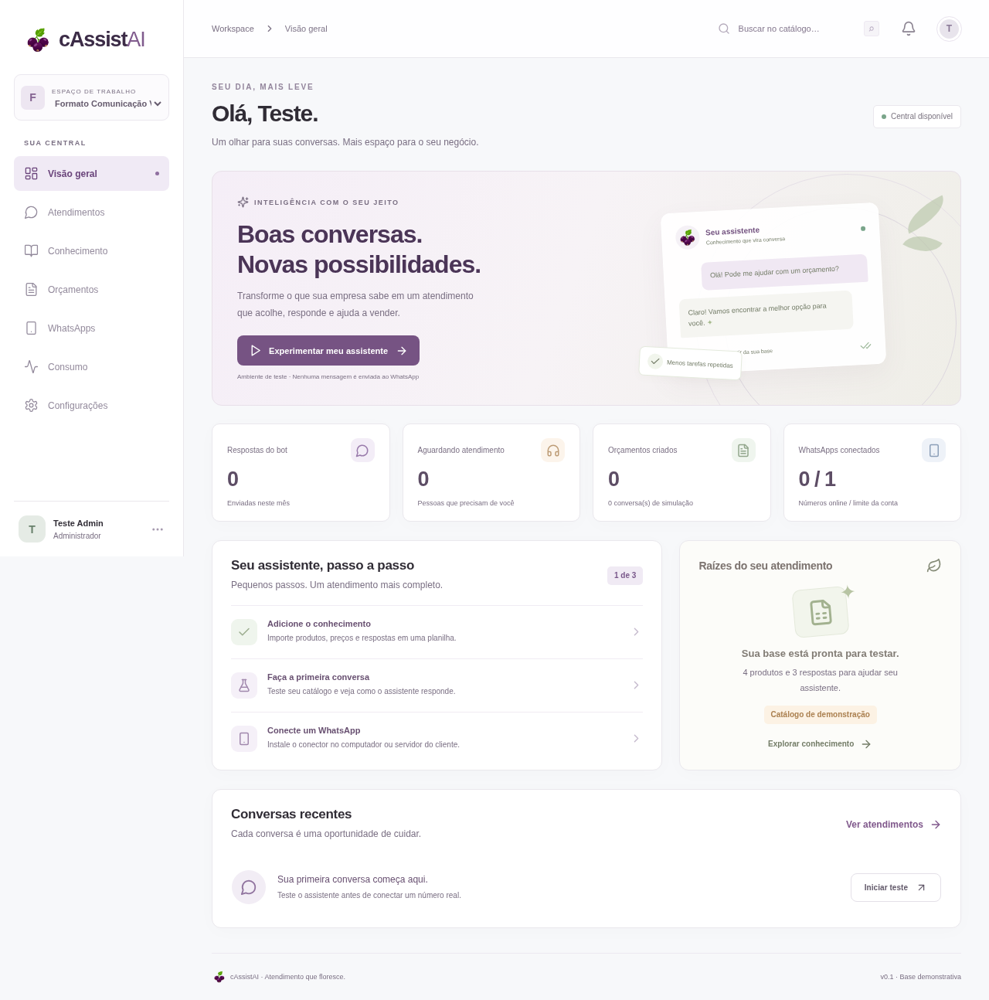

# cAssistAI


Central de atendimento para empresas, com base de conhecimento em Excel, orçamentos determinísticos, simulador, atendimento humano e conector local de WhatsApp.

**Esta é uma primeira versão funcional para desenvolvimento e piloto.** O painel e os fluxos locais foram testados. A conexão com um WhatsApp autorizado e chamadas reais a um provedor de IA ainda precisam de validação. Não há cobrança automática nem implantação pública.



## Abrir o app

### Windows, com dois cliques (recomendado)

1. Baixe o projeto: no GitHub, botão **Code → Download ZIP**, e extraia a pasta.
2. Dê dois cliques em **`Iniciar cAssistAI.bat`**. Se o Windows avisar que o arquivo veio da internet, clique em **Mais informações → Executar assim mesmo**.
3. Na primeira vez, ele instala o Node.js (se faltar) e os componentes, e pergunta a **chave do Groq** (grátis em https://console.groq.com/keys; aperte Enter para usar sem IA).
4. O Chrome abre no painel. Crie a conta, vá em **WhatsApps → Adicionar WhatsApp** e leia o QR Code com o celular (WhatsApp → Aparelhos conectados → Conectar aparelho).

Deixe a janela preta aberta: fechar a janela desliga o app e o WhatsApp. A configuração fica em `.env` (pode editar com o Bloco de Notas) e os dados em `data/`. Ao baixar uma versão nova, copie a pasta `data` e o arquivo `.env` para a pasta nova para não perder conversas e o pareamento.

Nesse modo (`LOCAL_CONNECTORS=true`), a central liga um conector do WhatsApp por número no mesmo computador, sem token para copiar. Em Mac/Linux: `node scripts/local-start.mjs`.

O arquivo [`cAssistAI-offline.html`](cAssistAI-offline.html) é só uma demonstração do painel: não tem WhatsApp nem IA.

### Manual, pelo terminal

Requisito: **Node.js 24 ou superior**.

```bash
git clone https://github.com/SpaceInvUK/Self-Service.git
cd Self-Service
npm ci
npm run build
npm start
```

Abra o endereço exibido no terminal, porta 3000 por padrão. A primeira tela permite criar a conta administradora: não existe senha compartilhada ou credencial fixa. Uma empresa de demonstração, Formato, é criada com quatro variantes de wind banner e perguntas frequentes.

Para desenvolvimento com atualização automática: `npm run dev`. Para configurar o servidor, copie `.env.example` para `.env`. Os scripts carregam esse arquivo automaticamente. Os comandos de inicialização também funcionam no Windows com Node 24.

## Experimente o fluxo completo

1. Crie sua conta administradora.
2. Na visão geral, clique em **Experimentar meu assistente**.
3. Envie `Quero 2 unidades WB-200`.
4. O simulador calcula R$ 560,00 e entrada de R$ 280,00, usando a base demonstrativa.
5. Envie `sim` para registrar o aceite e encaminhar ao atendente.
6. Clique em **Assumir** e responda como atendente.
7. Abra **Orçamentos → Detalhes → Confirmar venda**.

Simulações são identificadas e não consomem a franquia comercial. Se uma IA externa estiver configurada, chamadas no simulador podem ter custo de API.

## O que funciona

- Login, sessão por cookie HttpOnly, senhas com scrypt e logout.
- Administrador cria empresas, define limite de números/franquia e cadastra atendentes.
- Funcionário acessa apenas a empresa à qual foi associado.
- Download de modelo Excel e exemplo preenchido; prévia, erros por célula, ativação e restauração de versões.
- Catálogo, perguntas frequentes, horários e condições públicas por empresa.
- Bot por regras sem necessidade de chave de IA.
- Orçamento por unidade ou m², mínimo por item e percentual de entrada.
- Caixa de entrada, pausa, atendimento humano e devolução ao bot.
- Orçamentos enviados, aceitos, vendas confirmadas e perdas.
- Registro de consumo real e simulado, reserva de franquia e limite por número.
- Cadastro/revogação de conectores, QR real quando fornecido pelo conector e estado por heartbeat.
- Marca de cassis, interface responsiva e dados persistidos em SQLite.

## Excel

Baixe os arquivos no painel **Conhecimento**. A versão implementada do esquema é a **1.0**:

| Aba | Conteúdo |
|---|---|
| LEIA_ME | Instruções para pessoa ou IA preencher |
| EMPRESA | Nome, segmento, descrição pública e horário |
| PRODUTOS | Código único, nome, categoria, unidade UN/M2, preço, entrada, prazo, mínimo, ativo, descrição e sinônimos |
| PERGUNTAS | Pergunta, resposta aprovada e palavras-chave |
| CONDICOES | Pares chave/valor com condições comerciais públicas |

Uma linha de produto também pode representar uma variante. As abas adicionais descritas no projeto de longo prazo ainda não são implementadas. Limite: 5 MB, 2.000 linhas por aba e 2.000 caracteres por célula. Fórmulas, links e valores complexos são rejeitados. A planilha substitui toda a base ativa após revisão; preços de orçamentos anteriores permanecem preservados.

## WhatsApp no computador do cliente

1. Na central, abra **WhatsApps → Adicionar WhatsApp**.
2. Copie o token exibido uma única vez.
3. Na máquina do cliente, entre na pasta `connector`, execute `npm ci` e copie `.env.example` para `.env`.
4. Configure `CENTRAL_URL` com o endereço HTTPS acessível da central e `CONNECTOR_TOKEN` com o token.
5. Execute `npm start` dentro de `connector`.
6. Na central, clique em **Ver QR Code** e autorize o aparelho pelo WhatsApp.

A central e o conector podem rodar na mesma máquina para testes, usando loopback. Em máquinas diferentes, localhost não aponta para a central: configure um endereço HTTPS real. O conector só abre conexões de saída; não exige portas abertas na máquina do cliente.

O conector usa Baileys, uma integração **não oficial**. Pode exigir reconexão ou deixar de funcionar após mudanças do WhatsApp, além de risco de bloqueio da conta. Não foi pareado a um número real nesta entrega. Nenhum QR fictício é apresentado no painel.

Sessões ficam em `connector/auth/` e estão fora do Git. Não execute duas instalações com o mesmo token: lease distribuído ainda não foi implementado. Grupos e mídia não são suportados nesta versão; conteúdo não textual solicita atendimento humano. Reinicialização automática como serviço do sistema operacional ainda depende de instalação operacional.

Envios com confirmação perdida ficam como `sending`/`uncertain` e mantêm a reserva de consumo, sem reenvio automático. A reconciliação manual no painel é uma pendência para uso comercial. A fila de entrada do conector é persistente, mas ainda falta recuperação transacional completa de eventos em processamento na central após uma queda abrupta. Não considerar o protocolo validado contra todos os cenários de interrupção.

## IA opcional

Sem chave, a aplicação atende catálogo, perguntas por palavras-chave, horários e orçamentos com regras. Isso já permite testar o fluxo completo sem custo de API.

Para perguntas institucionais que não correspondam às regras, configure no `.env` da **central**. Com o Groq (plano gratuito), o `Iniciar cAssistAI.bat` já preenche `AI_BASE_URL=https://api.groq.com/openai/v1` e `AI_MODEL=auto`; `auto` consulta os modelos disponíveis na sua conta e escolhe o primeiro de uma lista de preferência (`server/index.mjs`). Para outro provedor:

```dotenv
AI_API_KEY=configure_localmente
AI_MODEL=modelo_disponivel_na_sua_conta
AI_BASE_URL=https://api.openai.com/v1
```

A integração implementada usa Chat Completions compatível com OpenAI. Não presumir compatibilidade com todo modelo/provedor. A chave permanece no servidor. Há timeout de 12 segundos, resposta de até 250 tokens e teto inicial de 100 chamadas registradas por empresa/dia. Este teto não é uma garantia de gasto contra falhas/requisições simultâneas; um orçamento monetário transacional precisa ser adicionado antes de comercialização.

Configure `AI_INPUT_USD_PER_MILLION` e `AI_OUTPUT_USD_PER_MILLION` **somente após verificar os preços oficiais**. A estimativa inicial não distingue descontos de cache. Sem preços configurados, o painel informa “Não calculado”. O código não inclui preços inventados e nenhuma chamada real de IA foi validada nesta entrega.

## Dados e operação

- Banco: `data/cassistai.sqlite`, com WAL. `DATA_DIR` permite mudar o diretório.
- Dados, arquivos de sessão e `.env` não são versionados.
- Backup consistente: pare a central antes de copiar todo o diretório `data`, ou use a API de backup do SQLite. Não copie apenas o arquivo principal durante escrita.
- Servidor padrão: loopback. Para acesso remoto, configure HTTPS via proxy reverso, `HOST=0.0.0.0`, `COOKIE_SECURE=true` e um `SETUP_TOKEN` aleatório antes de criar a primeira conta.
- Não exponha o servidor de desenvolvimento diretamente à internet.
- Limite de números, franquia e dados de empresas são verificados no servidor.
- A máquina do cliente não é uma fonte inviolável de confirmação de envios. O controle mais forte é o de autorização e uso da central/IA.

Antes de produção: recuperar senhas e trocar senhas iniciais, política de retenção/exclusão, proteção operacional e backups testados, controle monetário de IA, lease do conector, reconciliação de mensagens, expiração de fila, limites de tamanho do histórico, hardening de instalação e revisão da integração WhatsApp.

## Testes

```bash
npm test
npm run build
npm run test:e2e
```

Os testes de navegador usam Chromium em `/usr/bin/chromium` no ambiente cloud. Em outro sistema, ajuste `playwright.config.js` ou instale o Chromium do Playwright e remova `executablePath`. O banco de teste é temporário e independente do banco do app.

Cobertura: cálculo por unidade/área/mínimo, coleta de quantidade, transferência, importação e rejeição de fórmulas, fluxo no navegador desde cadastro até venda, separação entre empresas e limite simultâneo de conexões. Testes do protocolo do conector usam mensagens simuladas; não representam pareamento real do WhatsApp.

## Projeto e estado

Consulte [PROJETO_cAssistAI.md](PROJETO_cAssistAI.md). Alterações concluídas são commitadas e enviadas ao GitHub. Push de código não implanta nem publica o aplicativo.
